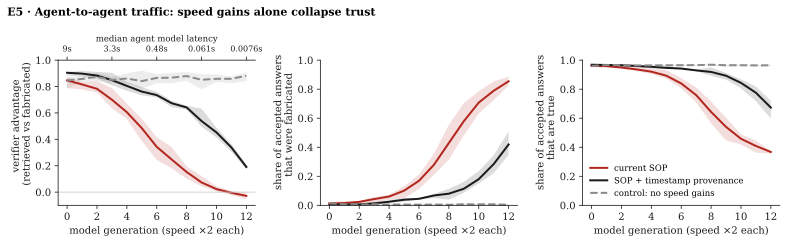

## Readpath: can an agent trust an MCP server?

*Theoretical study · October 2026 · [Formal model, simulation and code](https://github.com/LaumerLoma/readpath)*

AI agents ask MCP servers questions. Can a client tell whether an answer **existed before the
question**, or was **generated when the question arrived**? With query access alone, it cannot.

- **Asking can't show it.** A server that generates each answer on first request and stores it
  can't be told apart from one whose whole state was fixed in advance, however many questions the
  client asks.
- **Model checks don't help.** If the client checks answers only with its own model's reasoning,
  the server can run that same check first and send only answers that pass.
- **Timing was the last signal, and fast models remove it.** A model faster than retrieval can
  delay its answers until they look exactly like honest ones.
- **Commitments help, but only partly.** A server that publishes a hash of its state before the
  question can't invent answers afterwards. But it can still generate that state in advance, and
  the commitment says nothing about whether the content is true.
- **So trust reduces to selection.** When checking can't separate the two, an answer is worth
  exactly what the mechanism that picked the server is worth. Under open ranking, that is search
  engine optimization.

In a simulated network of 300 agents, where model speed doubles each generation, fabricating
servers come to handle most of the traffic. The share of accepted answers that are true falls
from 96% to 37%, while the answer rate rises from 71% to 99.7%: the network looks more helpful
as it gets worse.

The theorems hold for every verifier and server in the model. The simulation numbers are
illustrative, from stated assumptions. Nothing was measured, and no parameter was fitted.
